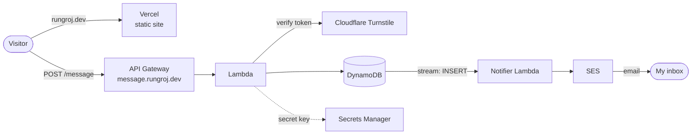

# Rungroj Rungsaranon · Portfolio

My personal portfolio: a **Next.js** site on my own domain, hosted on **Vercel** behind Cloudflare DNS, with a serverless contact API on **AWS** whose every resource is defined in **Terraform**.

🔗 **Live:** [rungroj.dev](https://rungroj.dev)

## 👨‍💻 About Me

I'm a **fullstack developer, AWS certified**. I build complete web apps with React, Next.js, Express and TypeScript, and run them on AWS infrastructure I define in Terraform, this site's contact API included.

- **Background:** B.Eng. in Civil Engineering, Chulalongkorn University.
- **Pivot:** moved into software by building small apps and tools all through university.
- **Certifications:** AWS Certified Solutions Architect – Associate · DataRockie Certified Professional Data Analyst · TOEIC 965/990 (CEFR C1).
- **Status:** open to junior fullstack and cloud engineer roles, Bangkok or remote.

## ✨ What's on the site

- **Hero:** open-to-work status, roles, resume, contact and main expertise, all on the first screen at every size.
- **How I build projects:** this site's architecture, request by request, plus my learning projects in a rotating, draggable 3D deck.
- **Skills:** my stack grouped by role, readable at a glance.
- **Background and credentials:** education, TOEIC, and certifications linked to their public records.
- **Contact:** a message form with live validation, a progress ring that fills as you write, and Cloudflare Turnstile against bots.
- Dark and light themes with a circular reveal, keyboard and screen-reader support, and reduced-motion support throughout.

## 🏗️ Architecture



- **Regions:** the AWS side runs in the AWS Thailand region (`ap-southeast-7`), including the API's ACM certificate and SES.
- **Site:** Next.js static export hosted on Vercel; the domain is registered with Cloudflare, whose DNS points `rungroj.dev` to Vercel and `message.rungroj.dev` to API Gateway. The earlier S3 + CloudFront hosting (private bucket, Origin Access Control, a CloudFront Function for clean URLs) is kept in `terraform-infra/infra/_parked/` and returns once CloudFront is available in my new AWS account.
- **Contact API:** API Gateway HTTP API on `message.rungroj.dev`, throttled (burst 10, 5 requests/s) with a CORS allow-list. The Lambda validates the body with zod, checks the Turnstile token with Cloudflare (secret key in Secrets Manager), then saves the message to DynamoDB with encryption at rest and point-in-time recovery.
- **Email notifications:** the table has a DynamoDB Stream (new images). A second Lambda consumes it through an event source mapping filtered to `INSERT` events (one record per batch, two retries) and sends each new message to my inbox with Amazon SES from `noreply@rungroj.dev`. The contact API never waits on email, so a slow or failed send can't break the form.
- **Infrastructure as code:** every AWS resource in Terraform, with remote state in a private S3 bucket with locking.
- **CI/CD:** Vercel builds and deploys the site on every push to `main`. The GitHub Actions deploy to S3 + CloudFront (AWS sign-in with OIDC, no stored keys) is paused with the CloudFront hosting.

## 🛠️ Tech Stack

| Area | Tools |
| :--- | :--- |
| **Framework** | [Next.js 16](https://nextjs.org/) (App Router, static export), [React 19](https://react.dev/) |
| **Language** | [TypeScript](https://www.typescriptlang.org/) |
| **Styling** | [Tailwind CSS 4](https://tailwindcss.com/) with design tokens ([DESIGN.md](frontend/DESIGN.md)) |
| **Forms and data** | [react-hook-form](https://react-hook-form.com/) + [zod](https://zod.dev/), [TanStack Query](https://tanstack.com/query), [zustand](https://zustand.docs.pmnd.rs/) |
| **Cloud** | Vercel (site) · AWS API Gateway, Lambda, DynamoDB (+ Streams), SES, ACM, Secrets Manager (contact API) |
| **Security** | [Cloudflare Turnstile](https://www.cloudflare.com/products/turnstile/), API throttling, CORS allow-list |
| **Infrastructure** | [Terraform](https://www.terraform.io/) |
| **CI/CD** | Vercel Git deploys; [GitHub Actions](https://github.com/features/actions) with AWS OIDC for the S3 deploy (paused) |

## 📂 Featured Projects

The site showcases these projects:

| Project | Type | Description | Tech Stack |
| :--- | :--- | :--- | :--- |
| **[Movie Ticketing](https://github.com/Imperator7/Movie-ticketing)** | From Scratch | Seat booking for Thai cinemas on AWS, all in Terraform (hosted demo paused while I move AWS accounts): CloudFront + WAF, S3, an internal ALB, ECS Fargate auto scaling 1–2 tasks on CPU, RDS, a CloudWatch CPU alarm that emails me through SNS, deployed by GitHub Actions with OIDC. ([repo](https://github.com/Imperator7/Movie-ticketing)) | Next.js, NestJS, PostgreSQL, Docker, ECS Fargate, RDS, Terraform |
| **[rungroj.dev](https://rungroj.dev)** | From Scratch | This site: on Vercel, with a serverless AWS contact API defined in Terraform. | Next.js, Tailwind, Vercel, API Gateway, Lambda, DynamoDB, SES, Terraform |
| **[Dine Together](https://github.com/Imperator7/Group-ordering)** | From Scratch | Group ordering: guests scan a table's QR code and order from their phones into one shared session. *In development.* | Next.js, TanStack Query, Zod, MongoDB |
| **[Task management](https://task-management-rungroj.vercel.app/)** | From Scratch | To-do app against a REST API mocked with MSW: loading and error states, optimistic updates. | React, TypeScript, TanStack Query, Zod, MSW |
| **[Note easy](https://github.com/Imperator7/note-easy)** | From Scratch | Notes and tasks with categories, sorting and full CRUD behind a sign-in. | Nuxt, Vue, TypeScript, Zod |
| **[Tic Tac Toe](https://tictactoe-from-react-docs.vercel.app/)** | From Scratch | The React tutorial rebuilt without copying, then compared and refactored. | React, TypeScript, Tailwind |
| **[Space Tourism](https://space-tour-figma-based.vercel.app/)** | Figma to Code | Multi-page site matched to the design at three breakpoints. | Next.js, TypeScript, Tailwind, Figma |

## 🗂️ Repository

```
.github/workflows/ deploy-frontend.yml: the S3 + CloudFront deploy (paused, manual only)
frontend/          the site (Next.js) — see frontend/README.md
terraform-infra/
  bootstrap/       one-time S3 bucket for Terraform's remote state
  infra/           API Gateway, Lambda, DynamoDB, SES and the hosting bucket
    message/       the contact Lambda (Node.js, zod)
    notifier/      the email notifier Lambda (DynamoDB Stream → SES)
    _parked/       CloudFront and the GitHub Actions OIDC role, until
                   CloudFront is available in the new account
```

## 🚀 Getting Started

```bash
cd frontend
npm install
cp .env.example .env   # add the Cloudflare Turnstile site key
npm run dev            # http://localhost:3000
```

| Command | What it does |
| :--- | :--- |
| `npm run dev` | Dev server on port 3000 |
| `npm run lint` | ESLint |
| `npm run typecheck` | TypeScript check |
| `npm run build` | Static site in `frontend/out/` |

**Deploy:** automatic. Vercel builds and deploys the site on every push to `main`; it needs `NEXT_PUBLIC_TURNSTILE_SITE_KEY` in the Vercel project's environment variables.

The earlier deploy, [`.github/workflows/deploy-frontend.yml`](.github/workflows/deploy-frontend.yml), is paused: it no longer runs on push and can only be started by hand. It builds the site, signs in to AWS with GitHub's OIDC token (no stored keys), syncs `frontend/out/` to S3 and invalidates CloudFront. It comes back with the CloudFront hosting.

## 📬 Contact

Feel free to reach out for opportunities or collaboration!

- **Email:** [rungrojr.ball@gmail.com](mailto:rungrojr.ball@gmail.com)
- **GitHub:** [Imperator7](https://github.com/Imperator7)
- **Or:** leave a message on [rungroj.dev](https://rungroj.dev/#contact)
