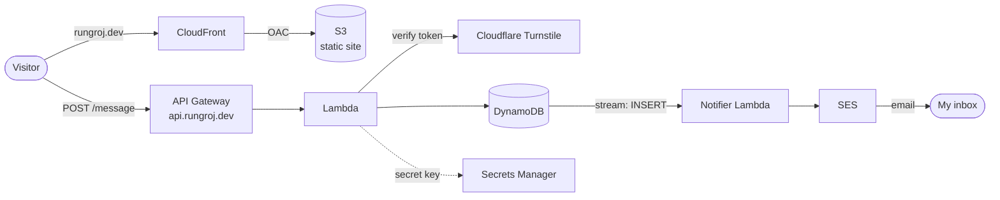

# Rungroj Rungsaranon · Portfolio

My personal portfolio: a **Next.js** site served from my own domain on **AWS**, with a serverless contact API and every cloud resource defined in **Terraform**. It's a portfolio piece in its own right: taken from a Vercel side project to production on infrastructure I own.

🔗 **Live:** [rungroj.dev](https://rungroj.dev)

## 👨‍💻 About Me

I'm a **fullstack developer, AWS certified**. I build complete web apps with React, Next.js, Express and TypeScript, and run them on AWS infrastructure I define in Terraform, this site included.

- **Background:** B.Eng. in Civil Engineering, Chulalongkorn University.
- **Pivot:** moved into software by building small apps and tools all through university.
- **Certifications:** AWS Certified Solutions Architect – Associate · DataRockie Certified Professional Data Analyst · TOEIC 965/990 (CEFR C1).
- **Status:** open to junior fullstack and cloud engineer roles, Bangkok or remote.

## ✨ What's on the site

- **Hero:** open-to-work status, roles, resume, contact and main expertise, all on the first screen at every size.
- **How I build projects:** this site's architecture, request by request, plus my learning projects in a rotating, draggable 3D deck.
- **Skills:** my stack grouped by role, readable at a glance.
- **Background and credentials:** education, TOEIC, and certifications linked to their public records.
- **Contact:** a message form with live validation, a progress ring that fills as you write, and Cloudflare Turnstile against bots.
- Dark and light themes with a circular reveal, keyboard and screen-reader support, and reduced-motion support throughout.

## 🏗️ Architecture



- **Regions:** everything runs in the AWS Thailand region (`ap-southeast-7`), except the CloudFront certificate in `us-east-1` (CloudFront only takes certificates from there) and SES in Singapore (`ap-southeast-1`). The API's certificate is in `ap-southeast-7`, beside API Gateway.
- **Site:** Next.js static export in a private S3 bucket (Block Public Access on), served only through CloudFront with Origin Access Control. HTTPS with ACM certificates; a CloudFront Function maps clean URLs to `.html` files.
- **Contact API:** API Gateway HTTP API on `api.rungroj.dev`, throttled (burst 10, 5 requests/s) with a CORS allow-list. The Lambda validates the body with zod, checks the Turnstile token with Cloudflare (secret key in Secrets Manager), then saves the message to DynamoDB with encryption at rest and point-in-time recovery.
- **Email notifications:** the table has a DynamoDB Stream (new images). A second Lambda consumes it through an event source mapping filtered to `INSERT` events (one record per batch, two retries) and sends each new message to my inbox with Amazon SES (Singapore) from `noreply@rungroj.dev`. The contact API never waits on email, so a slow or failed send can't break the form.
- **Infrastructure as code:** all of it in Terraform, with remote state in a private S3 bucket with locking. The domain is registered with Cloudflare.
- **CI/CD:** every merge to `main` that touches the site runs a GitHub Actions workflow: typecheck, lint and build, then sync to S3 and invalidate CloudFront. It signs in to AWS with OIDC, so there are no AWS keys in GitHub: the IAM role trusts only this repo's `main` branch and may only write the site bucket and invalidate its distribution.

## 🛠️ Tech Stack

| Area | Tools |
| :--- | :--- |
| **Framework** | [Next.js 16](https://nextjs.org/) (App Router, static export), [React 19](https://react.dev/) |
| **Language** | [TypeScript](https://www.typescriptlang.org/) |
| **Styling** | [Tailwind CSS 4](https://tailwindcss.com/) with design tokens ([DESIGN.md](frontend/DESIGN.md)) |
| **Forms and data** | [react-hook-form](https://react-hook-form.com/) + [zod](https://zod.dev/), [TanStack Query](https://tanstack.com/query), [zustand](https://zustand.docs.pmnd.rs/) |
| **Cloud** | AWS S3, CloudFront, ACM, API Gateway, Lambda, DynamoDB (+ Streams), SES, Secrets Manager |
| **Security** | [Cloudflare Turnstile](https://www.cloudflare.com/products/turnstile/), OAC, S3 Block Public Access |
| **Infrastructure** | [Terraform](https://www.terraform.io/) |
| **CI/CD** | [GitHub Actions](https://github.com/features/actions) with AWS OIDC |

## 📂 Featured Projects

The site showcases these projects:

| Project | Type | Description | Tech Stack |
| :--- | :--- | :--- | :--- |
| **[rungroj.dev](https://rungroj.dev)** | From Scratch | This site: fully serverless on AWS, with a contact API and every resource in Terraform. | Next.js, Tailwind, S3, CloudFront, Lambda, DynamoDB, Terraform, GitHub Actions |
| **[Dine Together](https://github.com/Imperator7/Group-ordering)** | From Scratch | Group ordering: guests scan a table's QR code and order from their phones into one shared session. *In development.* | Next.js, TanStack Query, Zod, MongoDB |
| **[Task management](https://task-management-rungroj.vercel.app/)** | From Scratch | To-do app against a REST API mocked with MSW: loading and error states, optimistic updates. | React, TypeScript, TanStack Query, Zod, MSW |
| **[Note easy](https://github.com/Imperator7/note-easy)** | From Scratch | Notes and tasks with categories, sorting and full CRUD behind a sign-in. | Nuxt, Vue, TypeScript, Zod |
| **[Tic Tac Toe](https://tictactoe-from-react-docs.vercel.app/)** | From Scratch | The React tutorial rebuilt without copying, then compared and refactored. | React, TypeScript, Tailwind |
| **[Space Tourism](https://space-tour-figma-based.vercel.app/)** | Figma to Code | Multi-page site matched to the design at three breakpoints. | Next.js, TypeScript, Tailwind, Figma |

## 🗂️ Repository

```
.github/workflows/ deploy-frontend.yml: build and deploy the site on merge to main
frontend/          the site (Next.js) — see frontend/README.md
terraform-infra/
  bootstrap/       one-time S3 bucket for Terraform's remote state
  infra/           S3, CloudFront, ACM, API Gateway, Lambda, DynamoDB, SES,
                   and the OIDC role GitHub Actions deploys with
    lambda/        the contact Lambda (Node.js, zod)
    notifier/      the email notifier Lambda (DynamoDB Stream → SES)
```

## 🚀 Getting Started

```bash
cd frontend
npm install
cp .env.example .env   # add the Cloudflare Turnstile site key
npm run dev            # http://localhost:3000
```

| Command | What it does |
| :--- | :--- |
| `npm run dev` | Dev server on port 3000 |
| `npm run lint` | ESLint |
| `npm run typecheck` | TypeScript check |
| `npm run build` | Static site in `frontend/out/` |

**Deploy:** automatic. Merging a change to `frontend/` into `main` runs [`.github/workflows/deploy-frontend.yml`](.github/workflows/deploy-frontend.yml):

1. Install, typecheck, lint and build the site. A failure stops the run, so the live site stays as it was.
2. Sign in to AWS with GitHub's OIDC token: AWS trades it for credentials that last about an hour, for the role `portfolio-github-deploy-frontend` (in `terraform-infra/infra/github-actions.tf`).
3. Sync `frontend/out/` to the S3 bucket (`--delete` removes old files) and invalidate CloudFront (`/*`).

It can also be started by hand from the repo's **Actions** tab (**Run workflow**). It reads four repository variables (Settings → Secrets and variables → Actions → Variables): `AWS_DEPLOY_ROLE_ARN`, `S3_BUCKET`, `CLOUDFRONT_DISTRIBUTION_ID` (all three from `terraform output` in `terraform-infra/infra`) and `TURNSTILE_SITE_KEY`.

## 📬 Contact

Feel free to reach out for opportunities or collaboration!

- **Email:** [rungrojr.ball@gmail.com](mailto:rungrojr.ball@gmail.com)
- **GitHub:** [Imperator7](https://github.com/Imperator7)
- **Or:** leave a message on [rungroj.dev](https://rungroj.dev/#contact)
